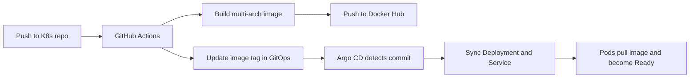

# GitOps Manifests - Argo CD Backend

This repository is the **desired-state** repository for the `argocd-backend` example. Argo CD watches `main` and the `k8s/` directory. The CI pipeline in the application repository builds the image and updates only the image tag in `k8s/deployment.yaml`.

| Item | Value |
| --- | --- |
| Application repository | `https://github.com/24thAbhinav/K8s` |
| GitOps repository | `https://github.com/24thAbhinav/GitOps` |
| Container image | `abhinavchauhan24/argocd-backend` |
| Argo CD Application | `learning-argocd` in namespace `argocd` |
| Argo CD version verified | `v3.5.6` |
| Destination | in-cluster (`https://kubernetes.default.svc`) / namespace `default` |
| Sync branch and path | `main` / `k8s` |

> [!WARNING]
> This repository must never contain credentials. Do not commit Docker Hub passwords, GitHub personal access tokens, kubeconfigs, private keys, or real `.env` values.

> [!IMPORTANT]
> The `GITOPS_TOKEN` used by CI is a fine-grained GitHub PAT with a **30-day expiry**. When it expires, the application repository's workflow fails while pushing to this repository. See [Token expiry and rotation](#token-expiry-and-rotation).

## Why this repository exists

The application repository (`K8s`) contains source code, Dockerfiles, workflow definitions, and learning manifests. This repository contains only the manifests that should run in the cluster.

That separation gives you:

- A reviewable history of what is deployed, independent of application code changes.
- One place for Argo CD to watch.
- A clean rollback path: point the image tag at a previous commit and push.
- No credentials in the application manifests.

The application repository never applies manifests directly. It only builds an image and opens a new commit here.

## Repository layout

```text
GitOps/
├── .gitignore
├── README.md
└── k8s/
    ├── deployment.yaml
    └── service.yaml
```

There are intentionally no GitHub Actions workflows in this repository. The pipeline lives in the application repository, so a CI commit here does not trigger another build.

## End-to-end flow



1. A developer pushes a change under `basics/argocd/backend/` in the `K8s` repository, or manually dispatches the workflow.
2. GitHub Actions builds `linux/amd64` and `linux/arm64` images.
3. The image is pushed as `abhinavchauhan24/argocd-backend:<short-sha>`.
4. The workflow checks out this repository and replaces the image tag in `k8s/deployment.yaml`.
5. The workflow commits and pushes to `main`.
6. Argo CD detects the new commit and syncs the Deployment and Service.
7. Kubernetes pulls the new image and performs a rolling update.

The tag is the first seven characters of the application repository commit SHA. The workflow never pushes `latest`.

## Argo CD Application

The bootstrap Application manifest lives in the application repository at `basics/argocd/argocd-application.yaml`. It points here:

```yaml
apiVersion: argoproj.io/v1alpha1
kind: Application
metadata:
  name: learning-argocd
  namespace: argocd
spec:
  project: default
  source:
    repoURL: https://github.com/24thAbhinav/GitOps.git
    targetRevision: main
    path: k8s
  destination:
    server: https://kubernetes.default.svc
    namespace: default
  syncPolicy:
    automated:
      enabled: true
      prune: false
      selfHeal: true
```

Important behavior:

- `path` must be `k8s`. If it points at `.`, Argo CD looks at the repository root and may report `Synced` while managing no resources.
- `prune: false` means deleting a manifest here does not automatically delete the live object. Delete the object manually, or enable pruning deliberately.
- `selfHeal: true` means a manual `kubectl edit` is reverted to the Git state. Git is the source of truth.
- The image tag must exist in Docker Hub before the Pods can start. If the tag is missing, Pods stay in `ImagePullBackOff` until a successful CI run pushes it.

## Manifests

### `k8s/deployment.yaml`

```yaml
apiVersion: apps/v1
kind: Deployment
metadata:
  name: argocd-backend-deployment
spec:
  replicas: 4
  selector:
    matchLabels:
      app: argocd-backend
  template:
    metadata:
      labels:
        app: argocd-backend
    spec:
      containers:
        - name: argocd-backend
          image: abhinavchauhan24/argocd-backend:<short-sha>
          ports:
            - containerPort: 3000
```

The CI workflow replaces the image line. A real manifest must use an existing tag, for example:

```yaml
image: abhinavchauhan24/argocd-backend:f1fbd30
```

`f1fbd30` is the last known multi-arch tag from the example setup. Always check the current file and Docker Hub rather than assuming a tag is still current.

### `k8s/service.yaml`

```yaml
apiVersion: v1
kind: Service
metadata:
  name: argocd-backend-service
spec:
  selector:
    app: argocd-backend
  ports:
    - protocol: TCP
      port: 3000
      targetPort: 3000
  type: ClusterIP
```

The Service is `ClusterIP`, so it is not exposed outside the cluster. Use `kubectl port-forward` for local verification, or add an Ingress/`LoadBalancer` Service if you need external access.

## First-time setup

### Prerequisites

- A Kubernetes cluster with `kubectl` configured. The example uses a local Kind cluster named `argo-cluster`.
- Argo CD installed in the `argocd` namespace.
- Access to this repository.
- A real image tag in `k8s/deployment.yaml`.

### Create the repository contents

If you are reproducing this from scratch:

```bash
git clone https://github.com/24thAbhinav/GitOps.git
cd GitOps
mkdir -p k8s
```

Create `k8s/deployment.yaml` and `k8s/service.yaml` using the manifests above, replacing `<short-sha>` with an existing image tag.

```bash
git add k8s/deployment.yaml k8s/service.yaml
git commit -m "feat: add argocd backend manifests"
git push origin main
```

### Install Argo CD

```bash
kubectl create namespace argocd --dry-run=client -o yaml | kubectl apply -f -
kubectl apply -n argocd -f https://raw.githubusercontent.com/argoproj/argo-cd/v3.5.6/manifests/install.yaml
kubectl -n argocd rollout status deployment/argocd-server
```

Access the UI:

```bash
kubectl -n argocd port-forward svc/argocd-server 8080:443
```

Open `https://localhost:8080`. The username is `admin`. Get the initial password with:

```bash
kubectl -n argocd get secret argocd-initial-admin-secret \
  -o jsonpath='{.data.password}' | base64 -d
echo
```

The certificate is self-signed, so the browser warning is expected for a local lab.

### Register the Application

Apply the bootstrap manifest from the application repository:

```bash
kubectl apply -f https://raw.githubusercontent.com/24thAbhinav/K8s/main/basics/argocd/argocd-application.yaml
```

Or clone the application repository and apply it locally:

```bash
git clone https://github.com/24thAbhinav/K8s.git
cd K8s
kubectl apply -f basics/argocd/argocd-application.yaml
```

If the Application already exists, `kubectl apply` updates it in place. Do not delete and recreate it unless you intend to reset its sync history.

### Wait for the first sync

```bash
kubectl -n argocd get application learning-argocd -w
```

Expected final state:

```text
NAME              SYNC STATUS   HEALTH STATUS
learning-argocd   Synced        Healthy
```

### Verify the workload

```bash
kubectl get deployment argocd-backend-deployment
kubectl get pods -l app=argocd-backend
kubectl get service argocd-backend-service
```

All four replicas should become Ready. To check the HTTP response locally:

```bash
kubectl port-forward service/argocd-backend-service 3000:3000
```

In another terminal:

```bash
curl http://localhost:3000/
```

Expected response:

```json
{"health":"OK"}
```

## How CI updates this repository

The workflow in the application repository runs this logic:

```bash
sed -i -E "s|image: abhinavchauhan24/argocd-backend:[^[:space:]]+|image: abhinavchauhan24/argocd-backend:${SHORT_SHA}|" k8s/deployment.yaml
```

It then commits with the `github-actions[bot]` identity and pushes to `main` using `GITOPS_TOKEN`.

Consequences:

- Only `k8s/deployment.yaml` is changed by CI.
- Replica count, Service settings, labels, and all other fields remain under human control.
- If the file already references the same SHA, the workflow exits without an empty commit.
- If you manually edit the image line, the next CI run overwrites it. Use the workflow for normal deploys.
- If you rename the image, update `IMAGE_NAME` in the workflow, this manifest, and the Docker Hub repository together.
- The workflow is serialized with a concurrency group, so two pushes do not race on the GitOps commit.

### Manual workflow run

```bash
gh workflow run argocd-backend-ci.yml \
  --repo 24thAbhinav/K8s \
  --ref main
```

Check the run:

```bash
gh run list \
  --repo 24thAbhinav/K8s \
  --workflow=argocd-backend-ci.yml \
  --limit 5
```

## Token expiry and rotation

The application repository needs three GitHub Actions secrets:

| Secret | Purpose | Recommended scope | Expiry |
| --- | --- | --- | --- |
| `DOCKERHUB_USERNAME` | Docker Hub login | Docker Hub username | Not applicable |
| `DOCKERHUB_TOKEN` | Docker Hub push | Read/write token for the image repository | 30 days |
| `GITOPS_TOKEN` | Push the image tag here | Fine-grained PAT for `24thAbhinav/GitOps`, Contents: Read and write | 30 days |

`GITHUB_TOKEN` is provided automatically and is not used for the GitOps push because it cannot write to another repository with the required permissions.

### Create the 30-day `GITOPS_TOKEN`

1. Open GitHub **Settings** -> **Developer settings** -> **Personal access tokens** -> **Fine-grained tokens**.
2. Click **Generate new token**.
3. Set an expiration of **30 days**.
4. Under **Repository access**, select **Only select repositories** and choose `24thAbhinav/GitOps`.
5. Under **Permissions** -> **Repository permissions**, set **Contents** to **Read and write**.
6. Generate the token and copy it once.

Add or update it in the application repository:

```bash
gh secret set DOCKERHUB_USERNAME --repo 24thAbhinav/K8s
gh secret set DOCKERHUB_TOKEN --repo 24thAbhinav/K8s
gh secret set GITOPS_TOKEN --repo 24thAbhinav/K8s
```

The commands prompt for the value, so it is not written to shell history.

### Rotation checklist

- Day 0: create the tokens with a 30-day expiry.
- Day 25: create replacements and update the GitHub Actions secrets.
- Day 30: the old tokens expire; revoke them if they are still listed.
- After updating, dispatch the workflow once and confirm it completes.
- If a token is exposed, revoke it immediately and replace the secret. Do not wait for the expiry date.

### Symptoms of an expired or under-scoped token

- Docker Hub: `Username and password required`, `unauthorized`, or `denied`.
- GitOps push: `403`, `Permission to 24thAbhinav/GitOps.git denied`, or `could not read Username`.
- Workflow succeeds at the image push but fails at **Update image tag and push GitOps manifest**.

## Day-2 operations

### Deploy a new backend version

Push a change under `basics/argocd/backend/` in the application repository. The workflow builds a new image, updates this repository, and Argo CD rolls it out.

### Roll back to a previous image

Find a known-good tag in Docker Hub or in the Git history:

```bash
git log --oneline -- k8s/deployment.yaml
```

Edit the image tag:

```yaml
image: abhinavchauhan24/argocd-backend:<previous-short-sha>
```

Commit and push:

```bash
git add k8s/deployment.yaml
git commit -m "revert: roll argocd backend back to <previous-short-sha>"
git push origin main
```

Argo CD normally notices within about three minutes. Force a refresh:

```bash
kubectl -n argocd annotate application learning-argocd \
  argocd.argoproj.io/refresh=normal --overwrite
```

`argocd app rollback` can change the live state temporarily, but if `selfHeal` is enabled the change is not durable. Update Git as well if you want the rollback to persist.

### Scale the Deployment

Edit `replicas` in `k8s/deployment.yaml`, commit, and push. Argo CD applies the change.

### Change the Service

Edit `k8s/service.yaml`, commit, and push. Keep `targetPort` aligned with the container port (`3000`).

### Pause automated sync

```bash
kubectl -n argocd patch application learning-argocd --type=merge \
  -p '{"spec":{"syncPolicy":{"automated":null}}}'
```

Re-enable it with:

```bash
kubectl -n argocd patch application learning-argocd --type=merge \
  -p '{"spec":{"syncPolicy":{"automated":{"enabled":true,"prune":false,"selfHeal":true}}}}'
```

Pausing sync is useful for debugging. Do not leave it disabled without a reason.

### Inspect Argo CD state

```bash
kubectl -n argocd get application learning-argocd
kubectl -n argocd get application learning-argocd \
  -o jsonpath='{.status.sync.status}{" / "}{.status.health.status}{"\n"}'
kubectl -n argocd get application learning-argocd \
  -o jsonpath='{.status.sync.revision}{"\n"}'
```

With the Argo CD CLI:

```bash
argocd app get learning-argocd --refresh
argocd app history learning-argocd
```

## Troubleshooting

| Symptom | Likely cause | Fix |
| --- | --- | --- |
| `ImagePullBackOff` with `no match for platform in manifest` | Image is amd64-only, but the Kind node is arm64 | Build and push `linux/amd64,linux/arm64`; verify with `docker buildx imagetools inspect` |
| `ImagePullBackOff` with `manifest unknown` | The tag in `deployment.yaml` does not exist | Trigger CI, or point at an existing tag |
| `ImagePullBackOff` with `unauthorized` | Docker Hub repository is private and no pull secret exists | Create a `docker-registry` Secret and add `imagePullSecrets` |
| GitOps push returns `403` | `GITOPS_TOKEN` lacks Contents: Read and write, is expired, or targets the wrong repository | Rotate the PAT and update the secret |
| Application is `Synced` but no Deployment or Service appears | `path` is not `k8s` | Patch the Application source path to `k8s` |
| Application is `OutOfSync` after a manual edit | `selfHeal` is reverting the cluster to Git | Commit the intended change here, or pause auto-sync while debugging |
| Pods are `Pending` | No schedulable node or insufficient resources | `kubectl describe pod` and `kubectl describe node` |
| Pods are `CrashLoopBackOff` | Application error | `kubectl logs deployment/argocd-backend-deployment` |
| Service does not respond from the host | `ClusterIP` is internal only | Use `kubectl port-forward` or add an Ingress |
| Argo CD cannot read this repository | Repository is private and Argo CD has no credentials | Add repository credentials in the `argocd` namespace |
| Workflow is not triggered by a docs change | Path filter only matches `basics/argocd/backend/**` | Expected; use `workflow_dispatch` if a rebuild is required |
| Workflow fails with `non-fast-forward` | A human or another workflow pushed to this repo first | Pull/rebase, or re-run the workflow |

### Force a sync

```bash
kubectl -n argocd annotate application learning-argocd \
  argocd.argoproj.io/refresh=normal --overwrite
```

Or, with the CLI:

```bash
argocd app sync learning-argocd
```

### Check the image architectures

```bash
docker buildx imagetools inspect abhinavchauhan24/argocd-backend:<short-sha>
```

The output should list both `linux/amd64` and `linux/arm64`.

## Security notes

- Never commit tokens, passwords, kubeconfigs, or real application secrets.
- Use a dedicated Docker Hub token rather than the account password.
- Give `GITOPS_TOKEN` the smallest scope that works: one repository, Contents read/write.
- Keep the token expiry at 30 days and rotate it before it lapses.
- Do not reuse the CI PAT for Argo CD repository access. Create a separate credential for the cluster if this repository becomes private.
- The Docker Hub token is for push. A private cluster needs a separate pull secret.
- Pin images by immutable SHA tags. Avoid `latest`.
- Review changes here before merging. This repository is the deployment source of truth.
- `prune: false` is a safety default. Enable pruning only when you understand which objects Argo CD is allowed to delete.
- If `main` is protected, allow the workflow identity to bypass the rule or switch to a pull-request-based GitOps flow.

## Cleanup

Delete the Application and the workloads it manages:

```bash
kubectl delete -f https://raw.githubusercontent.com/24thAbhinav/K8s/main/basics/argocd/argocd-application.yaml
kubectl delete -f https://raw.githubusercontent.com/24thAbhinav/GitOps/main/k8s/deployment.yaml
kubectl delete -f https://raw.githubusercontent.com/24thAbhinav/GitOps/main/k8s/service.yaml
```

Because the Application uses `prune: false`, deleting the Application does not delete the live Deployment or Service. The two commands above remove those objects explicitly.

Delete Argo CD:

```bash
kubectl delete -n argocd -f https://raw.githubusercontent.com/argoproj/argo-cd/v3.5.6/manifests/install.yaml
kubectl delete namespace argocd
```

Delete the local Kind cluster:

```bash
kind delete cluster --name argo-cluster
```

The Git repositories and Docker Hub images are not removed by these commands.

## Related documentation

- [Application repository](https://github.com/24thAbhinav/K8s)
- [Argo CD documentation](https://argo-cd.readthedocs.io/)
- [Argo CD Application specification](https://argo-cd.readthedocs.io/en/stable/user-guide/application-specification/)
- [GitHub Actions documentation](https://docs.github.com/en/actions)
- [Docker build-push-action](https://github.com/docker/build-push-action)
- [Kind documentation](https://kind.sigs.k8s.io/)
